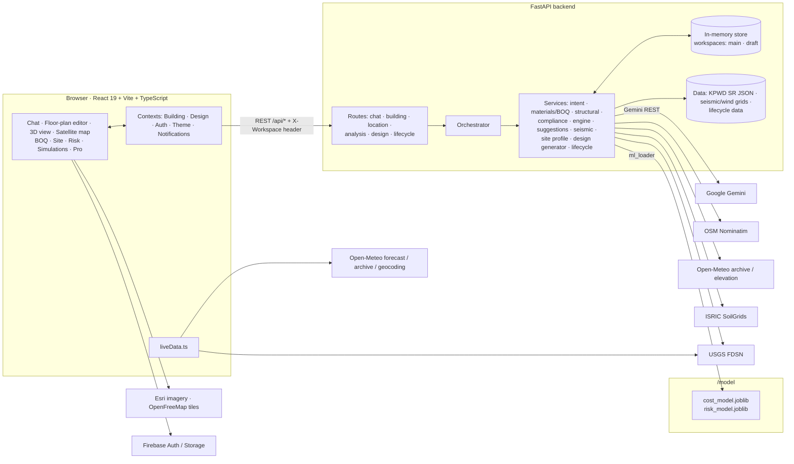
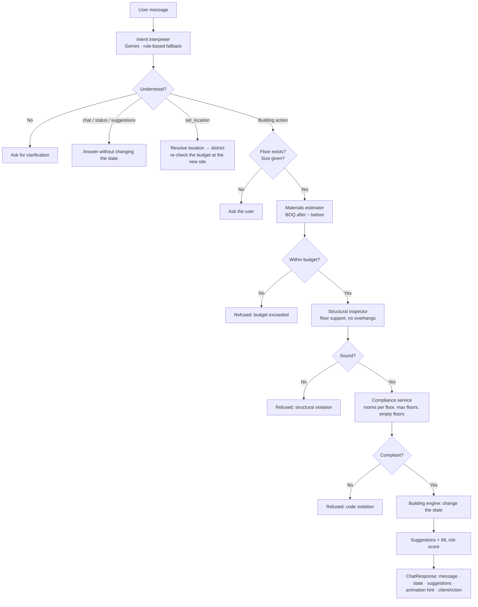

# 🏗️ निर्माण AI (Nirmaan AI): Building Intelligence Planner

Nirmaan AI is a conversational building planner for Karnataka. You describe a home in plain language or draw it on a floor plan. The app then checks every change against Indian building codes and prices it from the official Karnataka PWD Schedule of Rates (SR). It also runs an IS 1893 seismic analysis using official hazard data and places the house on a satellite map of the real site. Pro users can also generate a complete design from a written brief and see what the building will cost to maintain over its life.

> The language model only translates what you type. Every decision about cost, structure, codes and safety is made by deterministic engineering code, so the app can't be talked into an unsafe or unaffordable building.

---

## 📑 Contents

1. [Problem statement](#-problem-statement)
2. [Our solution](#-our-solution)
3. [Features](#-features)
4. [Architecture](#-architecture)
5. [The validation pipeline](#-the-validation-pipeline)
6. [Engineering and data sources](#-engineering-and-data-sources)
7. [Machine-learning models](#-machine-learning-models)
8. [Business model](#-business-model)
9. [Tech stack](#-tech-stack)
10. [Project structure](#-project-structure)
11. [Getting started](#-getting-started)
12. [API reference](#-api-reference)
13. [Testing](#-testing)
14. [Known limitations and roadmap](#-known-limitations-and-roadmap)

---

## ❗ Problem statement

Planning a house in India, even at the concept stage, means dealing with several questions at once:

- **Layout:** how many floors and rooms, how big, and where they go on the plot.
- **Structure:** whether the layout is physically sensible, and how it will behave in an earthquake.
- **Regulation:** fire-safety room limits, height limits, the elevator rule, and the seismic code (IS 1893).
- **Cost:** whether it fits the budget at *official* rates rather than a contractor's guess.
- **Long-term cost:** what the building will need in repainting, waterproofing and replacements over 30 years.

Today these questions are answered by hand, across disconnected tools: a sketch for the layout, a spreadsheet for the cost, and separate code books for compliance. That is slow and error-prone, and it is out of reach for anyone without civil-engineering training. A homeowner who just wants to know "what if I add a floor?" has no quick, trustworthy answer that covers cost, physics and regulation together.

There is also a gap between **conversation** and **formal design tools**:

- CAD and BIM software is powerful but hard to learn, and it isn't built for quick what-if questions.
- Chatbots answer in natural language, but they have no real model of the building. Nothing guarantees their answers are physically or financially valid.

Most cost calculators and "AI house planners" also use made-up per-square-foot numbers instead of the government Schedule of Rates that public works in Karnataka are actually priced from. Very few tools look at the real site: its seismic zone, design wind speed, measured climate, and the buildings already standing on the plot.

## 💡 Our solution

Nirmaan AI combines the ease of a chat with the rigour of an engineering checker:

1. **One authoritative building state.** The building is a structured `BuildingState` (floors, rooms with exact positions, walls, windows, parking and garden, plot, site and budget). It is never the free-form text of a language model.
2. **AI only translates.** Gemini turns a sentence such as "add 2 bedrooms of 200 sq ft on floor 1" into a structured action. If Gemini is unavailable, a rule-based parser takes over, so the app never depends on it.
3. **Deterministic checks decide.** Each action goes through budget, structural, compliance and placement checks. The state changes only if every check passes. The same request always gives the same verified result, however it was phrased.
4. **Official data everywhere.**
   - Costs come from the Karnataka PWD Schedule of Rates 2023-24 (Vol 2).
   - Seismic zones come from IS 1893:2016 and the BMTPC Vulnerability Atlas.
   - Wind comes from IS 875 (Part 3).
   - Climate is 3 years of measured ERA5 data.
   - Maintenance follows the CPWD Maintenance Manual 2019, and the building envelope follows Eco-Niwas Samhita 2018.

   Every figure carries its source. Placeholder values are labelled as placeholders.
5. **Immediate, visual feedback.** A 3D view, a floor-plan editor, a satellite site map, a line-by-line bill of quantities (BOQ), a risk score and suggestions all update with every change.

---

## ✨ Features

### 💬 Conversational design (chat)
- Natural-language commands: add or remove floors (including shaped floors), add or remove rooms by type and size, set the budget, rename rooms, reset the building, show the status, ask for suggestions, and set the location.
- Room types: bedroom, bathroom, kitchen, living, dining, hallway, office, store and general.
- Never invents sizes. If you don't state a room size, the app asks.
- Answers questions in context ("why is my risk high?", "what is a plinth area?") without changing the building.
- Location from chat:
  - "use my current location" makes the browser ask for GPS permission.
  - "build it in Mysuru" searches for the place.
  - "12.97, 77.59" uses the coordinates directly.
- Every reply comes with suggestion chips for the next step.

### 📐 Floor-plan editor and 3D visualizer
- **Plot and building setup:** plot size, built-up area, number of floors and building shape (rectangle, square, pyramid, L, U, T or courtyard).
- **Room placement:** click to place rooms on a 2D plan, then drag, resize or rotate them. Rooms are checked so they never leave the floor or overlap another room.
- **Presets:** "Add a 2BHK" (and similar) suggests a size for every room that fits the free space, and lets you edit them before anything is built.
- **Walls and windows:** wall thickness, plus windows for each room.
- **Site features:** parking and garden placed on the plot, and priced too.
- **3D view:** an interactive 3D building (CSS 3D transforms) with orbit, zoom, a focus on a single floor, show and hide floors, and a 2D/3D toggle.
- **Animations:** the view animates each change from the chat.

### 🗺️ Real site on a satellite map
- MapLibre GL map with **Esri World Imagery** satellite tiles and **OpenStreetMap buildings in 3D** (OpenFreeMap tiles; no API keys).
- Click the map, search a place or use GPS to set the site. Your house is extruded from its real floor footprints (3 m per storey) at the marked point, and you can turn it to any compass heading.
- **Occupied-plot check:** the plot outline is tested against loaded OpenStreetMap building outlines with a polygon-overlap test. A plot on an existing building is refused ("A building is already here"), and so is a rotation into one.
- Each site resolves to a Karnataka district through OpenStreetMap Nominatim, with a nearest-district fallback when offline.

### 💰 Cost from the Karnataka PWD Schedule of Rates
- **Bill of quantities** from the CBRI plinth-area relations in the SR (Addendum II): cement (in bags), steel, sand, aggregate, glass and so on. These are priced at Vol 2 basic rates, with the SR's own add-ons (1% sundries, 1% water, 10% overhead and 10% profit).
- **Fittings priced separately as finished items:** flooring per room, WC, wash basin and waterproofing per bathroom, sink per kitchen, and roof waterproofing.
- Each line shows its **SR item code and page**, and whether the rate is verified or a placeholder.
- **Optional 18% GST**, because SR rates exclude it.
- **Per-action cost:** the BOQ after the action minus the BOQ before it, checked against the remaining budget. Fallbacks: the BOQ first, then the ML cost model, then the original formula.
- **Rate search** across the parsed schedule: 1,175 finished items and 906 basic materials.

### 🌍 Seismic analysis (IS 1893 (Part 1):2016)
- **Equivalent static method** (cl. 7.6): base shear VB = Ah·W, using the Table 7 minimum, distributed as Qi = VB·Wi·hi² / ΣWj·hj².
- Seismic weight comes from IS 875 (Part 1) unit weights and IS 875 (Part 2) imposed loads, applied to your real floors, rooms and wall thickness.
- **Official zone** from the BMTPC Vulnerability Atlas and IS 1893 Annex E.
- **Soil texture** from ISRIC SoilGrids 2.0, shown as an indication only. IS 1893 Table 4 needs an on-site SPT test.
- **Earthquake history:**
  - the live USGS catalogue (M ≥ 3 since 1900) near the site
  - IMD epicentres (M ≥ 5) plotted on the BMTPC map
- Reports which code checks call for a dynamic analysis instead.

### 🌦️ Live site conditions and measured climate
- **Live weather** from Open-Meteo at the exact site coordinates: temperature, humidity, wind speed, gusts and direction, and solar radiation.
- **Site climate** from 3 years of the **ERA5 reanalysis** (Open-Meteo archive): peak temperatures, gusts and rainfall. A live gust is shown as a share of the strongest gust recorded at that spot.
- **NBC climate zone** (Part 8 Sec 1) worked out from that measured data, **elevation** from the Copernicus GLO-90 elevation model, and **basic wind speed Vb** from the NBC 2016 / IS 875 (Part 3) map.
- Live data is for display only and is never fed into the models.

### ⚠️ Risk scoring and suggestions
- **ML structural-risk score** (0 to 1) from the seismic zone, peak ground acceleration (PGA), soil, wind, altitude, floor count and how the load is spread. It is advisory and never blocks a change.
- **Suggestion engine:** structural balance fixes, budget warnings, the elevator advisory and next steps.
- **Risk toast:** a pop-up alert about structural risk.

### 👑 Pro: AI design generator
- Describe the home: *"3BHK on two floors with parking, budget 60 lakh"*.
- Gemini, or a rule-based parser as a fallback, extracts the requirements. Nothing the brief doesn't state is invented, and every fill-in (plot, sizes, site) is reported.
- **Search:** every combination of floor count, building shape and room size is built with the same engine the editor uses.
- **Validate:** each candidate is checked against the KPWD BOQ versus the budget, the compliance and structural rules, floor support, and the IS 1893 checks.
- **Pick:** the candidate that places every room within budget, preferring fewer IS 1893 warnings, then larger rooms, then fewer floors, then lower cost. If none qualifies, the app says why.
- The result opens as an **editable draft workspace**, separate from your own building. Live checks run as you edit it, and you can then **apply** or **discard** it.

### 👑 Pro: lifecycle and maintenance
- **Maintenance schedule:** how often each item needs work, from the CPWD Maintenance Manual 2019, multiplied by quantities measured from the plan and priced at KPWD "old work" rates. CPWD plinth-area yardsticks serve as a cross-check.
- **Service life:** CPWD component lives determine the replacements needed within the chosen time span, plus the building's economic life.
- **Envelope:** wall and roof U-values (BEE Table 7 conductivities) and RETV (Eco-Niwas Samhita 2018, eq. 4) for the measured climate zone.
- **Water:** IS 1172 per-person demand, and rooftop rainwater harvest by the CGWB formula using rainfall measured at the site.
- **What-if comparison**, side by side:
  - structure: RCC frame or load-bearing walls
  - wall material: burnt clay brick, fly-ash brick, concrete block or AAC block
  - wall thickness and plaster
  - roof type and insulation
  - exterior finish
  - glazing U-value and SHGC
  - number of occupants
  - time span (up to 100 years) and discount rate

### 🧭 Other pages
- **Simulations:** seismic zone, soil, IS 1893 results, earthquake catalogues and the measured site climate.
- **Datasets:** engineering parameters for each Karnataka district.
- **Profile and auth:** Firebase sign-in, a profile photo (upload up to 5 MB), settings, notifications, and light and dark themes.

---

## 🏛️ Architecture



**Key design decisions**

| Decision | Why |
|---|---|
| A single authoritative `BuildingState` on the server | The browser shows the state, and the server decides what changes. Chat, the editor and the generator all go through the same checks. |
| Gemini only for translation, with a rule-based fallback | It handles messy language without ever deciding anything that matters for safety. The app keeps working without an API key. |
| Workspaces (`main` and `draft`), chosen per request with the `X-Workspace` header | An AI-generated design can be edited with the normal tools without touching the user's own building. |
| Cost fallbacks: BOQ, then ML, then the original formula | The explainable, official estimate comes first, and the app never breaks if data or models are missing. |
| Hard rules stay deterministic, and ML is advisory only | A model must never approve an unsafe structure. The risk score only adds information. |
| Training and serving share `model/features.py` | Feature vectors can't drift between training and inference. |
| Live data is for display only | Model predictions stay deterministic and match training. |

---

## 🔁 The validation pipeline

Every chat command goes through `backend/orchestrator.py`:



| Step | Module | What it does |
|---|---|---|
| Interpret | `services/intent_interpreter.py`, `services/gemini_client.py` | Turns language into one of 15 actions. Gemini is called over REST with retries, and a rule-based parser is the fallback. |
| Cost | `services/materials_estimator.py`, `services/boq_estimator.py`, `services/sor_rates.py` | Previews the action and prices it with the KPWD bill of quantities (BOQ). |
| Structure | `services/structural_inspector.py` | An upper floor can't have more rooms than the floor below, and the ground floor must carry the most rooms. |
| Compliance | `services/compliance_service.py` | Maximum rooms per floor (fire safety), maximum floors, no empty floors, and the elevator advisory above 3 floors. |
| Geometry | `services/geometry.py` | Footprints for 7 shapes, plot layout, and placement checks (rooms stay inside the floor and don't overlap). |
| Change | `services/building_engine.py` | Applies the change, records the history and recalculates the budget from the BOQ. |
| Suggest | `services/suggestion_engine.py` | Balance fixes, budget alerts and next steps. |

When the server can't do something itself, such as reading the user's GPS, it returns `clientAction: "request_geolocation"`. The browser then asks for permission and posts the coordinates to `/api/location`.

---

## 📚 Engineering and data sources

| Area | Source | Where |
|---|---|---|
| Construction rates | Karnataka PWD **Schedule of Rates, Buildings 2023-24, Vol 2** (PDF in `data/`) | `backend/data/sor/`, built by `scripts/parse_kpwd_sor.py` |
| Material quantities | CBRI plinth-area relations, SR Addendum II (pp. 228–229), checked by hand | `quantity_relations.json` |
| Seismic zone | IS 1893 (Part 1):2016 Annex E and the BMTPC Vulnerability Atlas | `data/seismic/karnataka_seismic.json`, built by `scripts/build_hazard_data.py` |
| Wind | NBC 2016 / IS 875 (Part 3):2015 basic wind-speed map (BMTPC) | `data/seismic/karnataka_wind.json` |
| Loads | IS 875 Part 1 (unit weights) and Part 2 (imposed loads) | `services/seismic_analysis.py` |
| Climate | ERA5 reanalysis (ECMWF) via the Open-Meteo archive, classified with NBC Part 8 Sec 1 | `services/site_profile.py`, `liveData.ts` |
| Elevation | Copernicus GLO-90 elevation model via Open-Meteo | `services/site_profile.py` |
| Soil | ISRIC SoilGrids 2.0 (indication only) | `services/seismic_analysis.py` |
| Earthquakes | USGS FDSN (live) and IMD epicentres | `liveData.ts`, `seismic_analysis.py` |
| Geocoding | OpenStreetMap Nominatim (at most 1 request per second, cached) | `services/location_resolver.py` |
| Maintenance and service life | CPWD Maintenance Manual 2019 | `data/lifecycle/lifecycle_data.json`, built by `scripts/build_lifecycle_data.py` |
| Envelope | Eco-Niwas Samhita 2018 (BEE) | `services/lifecycle.py` |
| Water | IS 1172 and the CGWB rooftop-harvest formula | `services/lifecycle.py` |
| Map | Esri World Imagery, and OpenFreeMap (OpenStreetMap) vector tiles | `SiteMapView.tsx` |

---

## 🤖 Machine-learning models

Both models live in `/model`. They are trained on 8,000 synthetic samples grounded in engineering formulas, and served by `backend/services/ml_loader.py`.

| Model | Purpose | Inputs (selection) | Held-out metrics |
|---|---|---|---|
| **Cost model** (`cost_model.joblib`) | Fallback cost of an action when the BOQ can't preview it | Floors, rooms, area, action type, room-type mix, seismic zone, soil, wind | R² 0.998, MAE about ₹20k |
| **Risk model** (`risk_model.joblib`) | Advisory structural-risk score from 0 to 1 | PGA, seismic zone, floors, soil, wind index, altitude, room density and how evenly rooms are spread | R² 0.983, MAE 0.024 |

The risk labels come from a **HAZUS/GEM-style lognormal seismic fragility function**, `P(damage ≥ Moderate | Sa) = Φ(ln(Sa/Sa_median)/β)`. Its capacity thresholds are rescaled to India's IS 1893 PGA range, and wind and load irregularity are added as secondary terms. Feature importances and metrics are in each model's `.meta.json`, served by `GET /api/model-info`. See [`model/README.md`](model/README.md) and [`IMPLEMENTATION_MODEL.md`](IMPLEMENTATION_MODEL.md).

---

## 💼 Business model

The app is **freemium**:

| Plan | Price | Includes |
|---|---|---|
| **Free** | ₹0 | The designer (floor plans, rooms, windows, walls, parking and garden), the AI chat assistant, the KPWD SR cost estimate, and the IS 1893 seismic analysis with official hazard data |
| **Pro** | **₹999 / month** | Everything in Free in one workspace, plus the **AI design generator** (every design priced and checked against the budget and IS 1893), **lifecycle and maintenance** (CPWD schedules, KPWD repair rates, service lives), the **envelope check** (Eco-Niwas Samhita U-values and RETV), rainwater harvesting, and **what-if comparisons** of walls, roof, finishes and glazing |

**Target users:** homeowners planning a house, small builders and contractors, architecture and civil-engineering students, and early-stage designers in Karnataka.

**Value:** answers in minutes, backed by official sources, to questions that today take a consultant, a quantity surveyor and a code book.

> Payments aren't connected yet, so Pro is open for anyone to try.

---

## 🧰 Tech stack

| Layer | Technologies |
|---|---|
| Frontend | React 19, TypeScript, Vite, MapLibre GL, Lucide icons, Firebase (Auth and Storage), Vitest |
| Backend | Python, FastAPI, Pydantic v2, Uvicorn, httpx, python-dotenv |
| AI | Google Gemini (REST `generateContent`, model set by `GEMINI_MODEL`) with a rule-based fallback |
| ML | scikit-learn gradient-boosted trees, NumPy, pandas, joblib |
| Data and external services | KPWD SR (parsed with pypdf), BMTPC, IS codes, CPWD, Open-Meteo, USGS, ISRIC SoilGrids, OSM Nominatim, Esri, OpenFreeMap |

---

## 📂 Project structure

```text
archi-mind-ai/
├── backend/                     FastAPI app
│   ├── main.py                  App, CORS, workspace middleware, routers
│   ├── orchestrator.py          The validation pipeline for chat commands
│   ├── models/building.py       Pydantic schemas: BuildingState, Floor, Room, SiteLocation, BOQ…
│   ├── routes/                  chat · building · location · analysis · design · lifecycle
│   ├── services/                intent_interpreter, gemini_client, materials_estimator,
│   │                            boq_estimator, sor_rates, structural_inspector,
│   │                            compliance_service, building_engine, geometry,
│   │                            suggestion_engine, location_resolver, site_profile,
│   │                            seismic_analysis, design_generator, lifecycle, ml_loader
│   ├── state/store.py           In-memory store with "main" and "draft" workspaces
│   ├── data/
│   │   ├── sor/                 KPWD SR: items, materials, core rates, quantity relations, ASL
│   │   ├── seismic/             Karnataka seismic zones and wind-speed grid
│   │   └── lifecycle/           CPWD / Eco-Niwas / IS 1172 lifecycle data
│   ├── scripts/                 parse_kpwd_sor, build_hazard_data, build_lifecycle_data
│   └── tests/                   unittest suites (regression, design generator, lifecycle)
├── model/                       ML training: features, dataset generator, trainers, models/
├── frontend/                     React frontend
│   └── src/
│       ├── components/
│       │   ├── chat/            ChatPanel
│       │   ├── planner/         FloorPlanEditor, PresetDialog
│       │   ├── visualizer/      BuildingVisualizer (3D), SiteMapView (satellite), DesignPanel
│       │   ├── stats/           StatsPanel, BoqCard, SiteCard, LiveConditions
│       │   ├── pro/             DesignGenerator, LifecyclePanel
│       │   ├── pages/           Pro, Simulations, Datasets, Profile
│       │   ├── layout/ auth/ setup/ shared/
│       ├── context/             Building, Design, Auth, Theme, Notifications
│       ├── services/            api.ts (backend client), liveData.ts (Open-Meteo, USGS)
│       └── utils/               presets, rooms, shapes, walls, formatters
├── data/                        KPWD Schedule of Rates PDF (source document)
├── IMPLEMENTATION_LOCATION.md   Location + SR costing design and status
├── IMPLEMENTATION_MODEL.md      ML plan
└── SYSTEM_OVERVIEW.md           Problem and approach summary
```

---

## 🚀 Getting started

**Prerequisites:** Python 3.10+ and Node.js 18+.

### 1. Backend

```bash
cd backend
python -m venv venv
# Windows (PowerShell): .\venv\Scripts\Activate.ps1
# macOS/Linux:           source venv/bin/activate
pip install -r requirements.txt
cp .env.example .env          # then add your GEMINI_API_KEY (optional)
uvicorn main:app --reload --port 8000
```

The interactive API docs are at http://127.0.0.1:8000/docs.

| Variable | Default | Purpose |
|---|---|---|
| `GEMINI_API_KEY` | — | Natural-language understanding and the design brief. Without it, the rule-based parser is used. |
| `GEMINI_MODEL` | — | Optional Gemini model override |
| `INITIAL_BUDGET` | `5000000` | Starting budget (₹) |
| `MAX_FLOORS` | `10` | Height limit |
| `MAX_ROOMS_PER_FLOOR` | `12` | Fire-safety room limit |

### 2. Frontend

```bash
cd frontend
npm install
cp .env.local.example .env.local   # Firebase config for sign-in
npm run dev
```

The app runs at http://localhost:5173. Sign-in uses Firebase, so fill in the `VITE_FIREBASE_*` values from your Firebase project.

### 3. (Optional) Retrain the models

```bash
cd model
pip install -r requirements.txt
python generate_dataset.py --n 8000 --seed 42
python train_cost_model.py
python train_risk_model.py
```

### 4. (Optional) Rebuild the data files

```bash
cd backend
python scripts/parse_kpwd_sor.py        # KPWD SR PDF → data/sor/*.json
python scripts/build_hazard_data.py     # seismic zones and wind grid
python scripts/build_lifecycle_data.py  # CPWD / ENS / IS 1172 lifecycle data
```

---

## 🔌 API reference

All routes have the `/api` prefix. Send `X-Workspace: draft` to work on the AI-generated draft instead of the main building.

| Method | Path | Purpose |
|---|---|---|
| POST | `/chat` | Run a natural-language command through the pipeline |
| GET | `/state` | The current `BuildingState` |
| POST | `/reset` | Reset the building |
| POST | `/configure` | Set up the plot, area, floors, shape and budget |
| POST · PATCH · DELETE | `/rooms`, `/rooms/{id}` | Place, move or resize, and delete a room |
| POST | `/rooms/batch` | Add several rooms (presets) |
| PUT | `/rooms/{id}/windows` | Set a room's windows |
| PUT | `/walls` | Wall settings |
| PATCH · DELETE | `/floors/{n}` | Change a floor's shape, or remove it |
| POST · PATCH · DELETE | `/site-features`, `/site-features/{id}` | Parking and garden |
| GET | `/model-info` | ML model cards (metrics and importances) |
| POST | `/location` | Set the site from GPS, the map, coordinates or a search |
| GET | `/location/geocode?q=` | Search for a place |
| PUT | `/location/heading` | Rotate the building on the site |
| GET | `/estimate/boq` | Full bill of quantities with SR references |
| PUT | `/estimate/gst` | Turn 18% GST on or off |
| GET | `/rates/meta` · `/rates/search?q=` | SR edition and notes, and search the schedule |
| GET | `/site-profile` | Zone, wind, climate zone, elevation and quakes for a point |
| GET | `/districts/profiles` | Profiles of all supported districts |
| GET | `/analysis/structural-risk` | ML risk score |
| GET | `/analysis/seismic-demand` · `/analysis/seismic` | IS 1893 seismic analysis |
| POST · GET · DELETE | `/design/generate`, `/design/draft` | Generate, read or discard an AI design |
| POST | `/design/draft/apply` | Replace the main building with the draft |
| POST | `/lifecycle` · `/lifecycle/compare` | Lifecycle report, and a what-if comparison |
| GET | `/lifecycle/sources` | The sources behind every lifecycle figure |

---

## 🧪 Testing

```bash
# Backend (44 tests: regression, design generator, lifecycle)
cd backend
python -m unittest discover -s tests -t .

# Frontend
cd frontend
npm test        # Vitest
npm run lint
npm run build   # type-check and production build
```

The backend tests turn Gemini off (or mock it) and stub the Open-Meteo site profile.

---

## 🚧 Known limitations and roadmap

- **Vol 1 rates are pending.** Cement, steel, sand and aggregate basic rates, wages, and the district Area Specific Loading are in KPWD SR **Vol 1** and the quarterly notifications. They are clearly marked placeholders for now. Until they are entered, location changes cost through an interim seismic, soil and wind premium.
- **Plinth-area relations** are valid for 30 to 300 m² and up to 4 storeys. Beyond that range, estimates are extrapolated and flagged as approximate.
- **Karnataka only:** the SR applies only within the state. Sites outside it get a warning.
- **The occupied-plot check uses OpenStreetMap only.** It misses buildings that were never mapped, and doesn't yet check roads, water or land use. Planned: those layers, plus Google or Microsoft open building footprints.
- **The ML models are trained on synthetic data.** The cost model is not yet retrained on BOQ-labelled data.
- **State is in memory.** It resets when the backend restarts and is not yet stored per user.
- **Payments** for Pro are not connected yet.

---

<sub>Built with FastAPI, React and official Indian engineering data. All rates are at KPWD SR 2023-24 levels, exclude GST unless it is turned on, and are estimates for planning only. They are not a substitute for a structural engineer's design.</sub>
