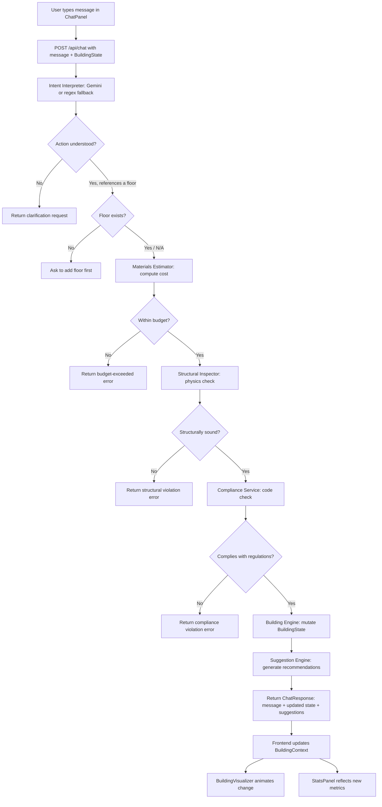

# System Overview

## Problem Statement

Planning a building — even at a conceptual stage — usually requires a person to juggle several concerns at once: how many floors and rooms are needed, whether the layout is structurally sensible, whether it satisfies local building codes (fire safety, maximum height, mandatory elevators), and whether all of this fits within a budget. Today this is typically done by hand or across disconnected tools — a sketch for layout, a spreadsheet for cost, and separate manual reference to building codes and engineering norms. This is slow, error-prone, and inaccessible to anyone without architecture or civil engineering training. A homeowner, student, or early-stage designer who just wants to ask "what if I add a floor?" has no easy way to get an immediate, trustworthy answer that accounts for cost, physics, and regulation simultaneously.

There is also a gap between *natural conversation* and *formal design tools*. Existing CAD or BIM software is powerful but has a steep learning curve and isn't built for quick, exploratory "what-if" questions. Conversely, chatbots that just generate text can answer in natural language but have no real model of the building, so they cannot guarantee their answers are physically or financially valid. निर्माण AI exists to close that gap: give users the ease of a conversational interface, but back every response with an actual state machine and domain-specific validation, so suggestions are not just plausible-sounding text but verified, buildable outcomes.

## Why This Solution Works

निर्माण AI resolves this by treating the building as a single authoritative, structured state (`BuildingState`) rather than letting the language model "imagine" a free-form answer. The LLM's only job is translation — converting a loose English sentence into a precise action and parameters (e.g., `add_rooms`, `floor_number: 1`, `count: 2`). From that point on, deterministic Python services, not the LLM, decide whether the action is allowed: a materials estimator computes real cost against the Indian Lakh/Crore budget, a structural inspector enforces physical constraints like no floating overhangs, and a compliance service checks it against fire-safety and height regulations modeled on Indian codes (IS 1893, IS 875). Only if every gate passes does the building engine mutate the state.

This separation of concerns is what makes the solution trustworthy: the AI handles ambiguity and language, while hand-written engineering logic handles correctness. Because the pipeline always runs the same checks regardless of how the request was phrased, two different users asking the same thing in different words get the same validated outcome — the system can't be "talked into" an unsafe or unaffordable building. The regional Karnataka district data grounds costs and constraints in something closer to real-world figures rather than arbitrary numbers, and the live 2.5D visualizer plus suggestion engine turn each validated change into immediate, visible, actionable feedback. In short: natural language lowers the barrier to entry, and the orchestrated validation pipeline guarantees the output is still a feasible, code-compliant building — giving non-experts a fast, safe way to explore building design decisions that would otherwise require specialist tools or expertise.

निर्माण AI is an interactive building planner combining a React/TypeScript frontend with a FastAPI backend. Users describe changes in natural language (e.g., "add 2 bedrooms to floor 1") via a chat panel; a Gemini-powered intent interpreter converts this into structured actions. A multi-step MCP orchestrator pipeline then validates each action—checking materials cost, structural integrity (no floating overhangs), and building-code compliance (fire safety, height limits)—before mutating the authoritative building state. A 2.5D CSS 3D visualizer renders the result live, while a suggestion engine offers smart next steps and budget warnings, grounded in real Karnataka regional engineering data.

## How It Works

Each decision point can halt the pipeline early with a clarification, budget, structural, or compliance error — so only valid, affordable, and safe changes ever reach the live building state.
